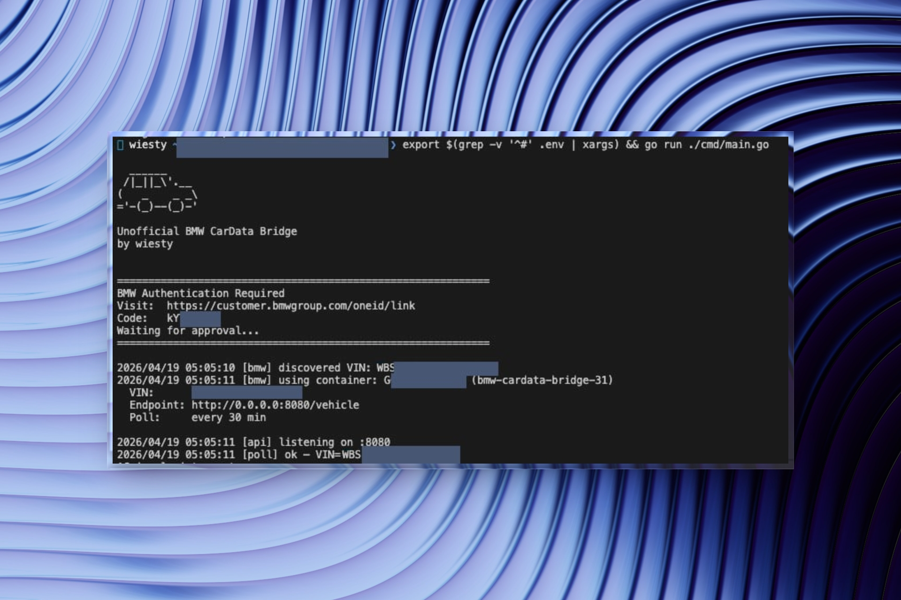

# Wiestys BMW CarData Gateway

A minimal local REST bridge for the [BMW CarData API](https://bmw-cardata.bmwgroup.com/customer/public/api-documentation). Exposes vehicle telemetry as a simple HTTP endpoint — single or multi-vehicle.



---

## Endpoints

| Endpoint | Description |
|----------|-------------|
| `GET /vehicle` | Latest telemetry (single-vehicle shortcut) |
| `GET /vehicle/{vin}` | Latest telemetry for a specific VIN |
| `GET /vehicles` | List all tracked VINs and their status |
| `GET /health` | Service status + last poll timestamp |
| `GET /docs` | Swagger UI |
| `GET /openapi.json` | OpenAPI 3.0 spec |

---

## `/vehicle` Response

All fields except `mileage_km` and `last_update` are optional — they're omitted when not supported by your vehicle.

Example: ICE (combustion engine)
```json
{
  "mileage_km": 45000,
  "last_update": "2026-04-19T12:00:00Z",
  "range_km": 520,
  "range_fuel_km": 520,
  "fuel_level_pct": 78,
  "fuel_level_liters": 46.8,
  "is_moving": false,
  "is_ignition_on": false,
  "is_engine_on": false,
  "doors_locked": "LOCKED",
  "doors_status": "CLOSED",
  "trunk_open": false,
  "service_distance_km": 12000
}
```

Example: BEV (full electric)
```json
{
  "mileage_km": 12345,
  "last_update": "2026-04-19T12:00:00Z",
  "range_km": 380,
  "range_electric_km": 380,
  "battery_soc_pct": 92.5,
  "battery_soc_target_pct": 100,
  "charging_status": "CHARGING",
  "charging_power_kw": 11.0,
  "charging_time_remaining_min": 45,
  "is_plugged_in": true,
  "doors_locked": "LOCKED",
  "doors_status": "CLOSED",
  "trunk_open": false,
  "service_distance_km": 8500
}
```

| Field | Unit | Vehicle types |
|-------|------|---------------|
| `mileage_km` | km | All |
| `range_km` | km | All (best available) |
| `range_electric_km` | km | BEV, PHEV |
| `range_fuel_km` | km | ICE, PHEV |
| `battery_soc_pct` | % | BEV, PHEV |
| `battery_soc_target_pct` | % | BEV, PHEV |
| `charging_status` | string | BEV, PHEV |
| `charging_power_kw` | kW | BEV, PHEV |
| `charging_time_remaining_min` | min | BEV, PHEV |
| `is_plugged_in` | bool | BEV, PHEV |
| `fuel_level_pct` | % | ICE, PHEV |
| `fuel_level_liters` | l | ICE, PHEV |
| `is_moving` / `is_ignition_on` / `is_engine_on` | bool | All |
| `doors_locked` / `doors_status` | string | All |
| `door_*_open` / `trunk_open` / `hood_open` | bool | All |
| `lights_on` | bool | All |
| `tire_pressure_*_kpa` | kPa | All |
| `tire_diagnosis` | string | All |
| `service_distance_km` | km | All |
| `check_control_messages` | string | All |

---

## Expanded vehicle data

`GET /vehicle` and `GET /vehicle/{vin}` include:

- `basic_data`: BMW metadata such as model, series, engine, production date, colour and equipment codes. Retrieved once and persisted with the vehicle cache.
- `telematic_data`: every populated descriptor returned by BMW, with its original string `value`, `unit` and source `timestamp`. Unknown or empty descriptors are omitted. JSON encoded inside a BMW value remains a string here.
- `service_messages`: parsed condition-based service (CBS) messages, including title, status, due date and BMW's original distance string. `unitOfLengthRemaining` uses the vehicle's distance unit; it is not converted by the bridge.
- Optional convenient fields for `latitude`, `longitude`, `altitude_m`, `heading_deg`, window status, alarm status, preconditioning, battery voltage, coolant temperature and tyre pressure targets.

`last_update` is the bridge's poll time. Use each entry's timestamp in `telematic_data` to determine how old the vehicle reading actually is. Source units are retained; charging power in the simplified `charging_power_kw` field is converted from W when necessary.

The descriptor snapshot comes from the [BMW catalogue API](https://www.bmw.co.uk/en-gb/utilities/bmw/api/cd/catalogue), retrieved on 2026-10-23: 294 entries, of which 285 can be requested in the shared telemetry container. Basic data and keys for dedicated endpoints (image, charging history/settings, tyre diagnosis) are excluded from that container. Static metadata uses `/basicData`; other dedicated endpoints are not polled by the bridge.

See [Catalogue coverage](docs/catalogue-coverage.md) for supported data categories and availability limitations.

## Setup

### 1. Get a BMW Client ID

1. Login into your BMW Account
2. Go to your [vehicle](https://www.bmw.de/de-de/mybmw/vehicle-overview?icp=navi_ocpflyout_garage)
3. Select BMW CarData
4. Activate Technical access to BMW CarData and select both checkmarks
5. Copy Client ID

### 2. Run with Docker

**Option A — docker compose** (build the current checkout):

```bash
cp .env.example .env
# Set BMW_CLIENT_ID in .env, then:
docker compose up -d --build
docker compose logs -f
```

**Option B — one-liner** (no file editing needed):

```bash
docker run -d \
  --name bmw-cardata-gateway \
  --restart unless-stopped \
  -e BMW_CLIENT_ID=your-client-id-here \
  -e POLL_INTERVAL_MINUTES=30 \
  -p 8080:8080 \
  -v /path/to/local/data:/data \
  ghcr.io/wiesty/bmw-cardata-gateway:latest
```

---

## Environment Variables

| Variable | Default | Description |
|----------|---------|-------------|
| `BMW_CLIENT_ID` | — | **Required.** From BMW CarData portal |
| `REST_PORT` | `8080` | HTTP server port |
| `POLL_INTERVAL_MINUTES` | `30` | Poll interval per vehicle (min: 10) |
| `DATA_DIR` | `/data` | Directory for token + state files |
| `CORS_ORIGINS` | `*` | Allowed CORS origins. `*` = allow all. Comma-separated for restrictions, e.g. `http://localhost:3000,https://myapp.com` |
| `API_KEY` | _(unset)_ | Optional API key. If set, all endpoints require `X-API-Key: <value>` or `Authorization: Bearer <value>` header |
| `BMW_VINS` | _(unset)_ | Comma-separated list of VINs to track. If unset, the primary VIN is auto-discovered |

---

## Multi-Vehicle Support

> **Same account only.** `BMW_VINS` works for vehicles that belong to the **same BMW account**. Authentication happens once per account (device code flow on first start), and the resulting token covers all vehicles on that account. For vehicles on different BMW accounts, run separate bridge instances with different `BMW_CLIENT_ID` values and different ports.

To track multiple vehicles, set `BMW_VINS`:

```bash
docker run -d \
  --name bmw-cardata-gateway \
  --restart unless-stopped \
  -e BMW_CLIENT_ID=your-client-id-here \
  -e BMW_VINS=WBA12345678901234,WBA98765432109876 \
  -p 8080:8080 \
  -v /path/to/local/data:/data \
  ghcr.io/wiesty/bmw-cardata-gateway:latest
```

On first start you authenticate **once** — the token is shared across all vehicles:

```
============================================================
BMW Authentication Required
Visit:  https://customer.bmwgroup.com/...
Code:   ABCD-1234
Waiting for approval...
============================================================

  VINs:     WBA12345678901234, WBA98765432109876
  Endpoint: http://0.0.0.0:8080/vehicle
  Poll:     every 30 min
```

Each VIN gets its own independent polling goroutine and state file (`state_<VIN>.json`). The shared data container is reused across all vehicles — adding more VINs does **not** increase API call frequency per vehicle.

```bash
# List all tracked vehicles
GET /vehicles
# → [{"vin":"WBA123...","last_update":"...","ready":true}, ...]

# Get telemetry for a specific vehicle
GET /vehicle/WBA12345678901234
```

### Multi-Account setup

If your vehicles are on different BMW accounts, run one instance per account:

```yaml
# docker-compose.yml
services:
  bmw-account-a:
    image: ghcr.io/wiesty/bmw-cardata-gateway:latest
    ports: ["8080:8080"]
    environment:
      BMW_CLIENT_ID: client-id-account-a
      BMW_VINS: WBA12345678901234
    volumes: [bmw_data_a:/data]

  bmw-account-b:
    image: ghcr.io/wiesty/bmw-cardata-gateway:latest
    ports: ["8081:8080"]
    environment:
      BMW_CLIENT_ID: client-id-account-b
      BMW_VINS: WBA98765432109876
    volumes: [bmw_data_b:/data]

volumes:
  bmw_data_a:
  bmw_data_b:
```

Each instance authenticates independently and stores its own `session.json` in its volume.

> **Rate limit note:** BMW documents a daily quota of 50 REST requests, reset at 00:00 UTC. Each vehicle poll makes a separate request, and discovery and container management also use requests. With multiple vehicles, increase `POLL_INTERVAL_MINUTES` to leave enough quota for all vehicles and startup requests.

---

## API Key Authentication

To protect the API (e.g. when exposed outside your local network):

```bash
-e API_KEY=my-secret-token
```

Then include the key in every request:

```bash
# Via header
curl -H "X-API-Key: my-secret-token" http://localhost:8080/vehicle

# Via Bearer token
curl -H "Authorization: Bearer my-secret-token" http://localhost:8080/vehicle
```

The `/docs` endpoint is always publicly accessible so you can browse the API spec.

---

## CORS Configuration

By default all origins are allowed (`*`). To restrict access to specific origins:

```bash
-e CORS_ORIGINS=http://localhost:3000,https://dashboard.myapp.com
```

---

## Rate Limits

BMW documents 50 REST requests per day, reset at 00:00 UTC. All 285 container descriptors are fetched in **one** API call per vehicle and interval. At 30 minutes, one vehicle uses 48 polling requests/day, leaving little room for startup or other API calls. Use 60 minutes to leave more headroom. See the [BMW integration guide](https://bmw-cardata.bmwgroup.com/customer/public/api-documentation).

## Persistence

| File | Contents |
|------|----------|
| `$DATA_DIR/session.json` | OAuth tokens (auto-refreshed) |
| `$DATA_DIR/state.json` | Container ID + VIN (single-vehicle) |
| `$DATA_DIR/state_<VIN>.json` | Per-vehicle poll state (multi-vehicle mode) |

Descriptor changes automatically select a new container using a content hash. The first poll then refreshes the telemetry cache.

Without `BMW_VINS`, the primary vehicle is discovered from your BMW account on each start. When the VIN changes, the previous vehicle's cached telemetry is discarded. Set `BMW_VINS` to explicitly select a vehicle when multiple primary vehicles are mapped to your account.

On first start, the container prints an auth URL to stdout:

```
============================================================
BMW Authentication Required
Visit:  https://customer.bmwgroup.com/...
Code:   ABCD-1234
Waiting for approval...
============================================================
```

Open the URL, enter the code, confirm — done. Tokens are persisted to the Docker volume and refreshed automatically on restart.

### 3. Run locally (development)

Requires Go 1.27.3 or newer (Go can download the required toolchain automatically).

```bash
set -a
source .env
set +a
export DATA_DIR="${DATA_DIR:-$PWD/data}"
mkdir -p "$DATA_DIR"
go run ./cmd/main.go
```

---

## GitHub Actions

Pushes to `main` or `master` run tests and vet, then build and publish a multi-platform image (`amd64`, `arm64`, `arm/v7`, `arm/v6`) to:

```
ghcr.io/wiesty/bmw-cardata-gateway:latest
```

---

The BMW OAuth device-code flow, token refresh, session persistence, and CarData API client are implemented directly in this bridge.

## License

[Apache 2.0](LICENSE) — this project is not affiliated with or endorsed by BMW Group.
